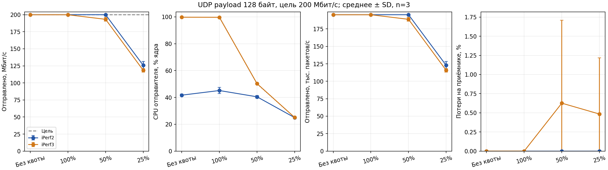
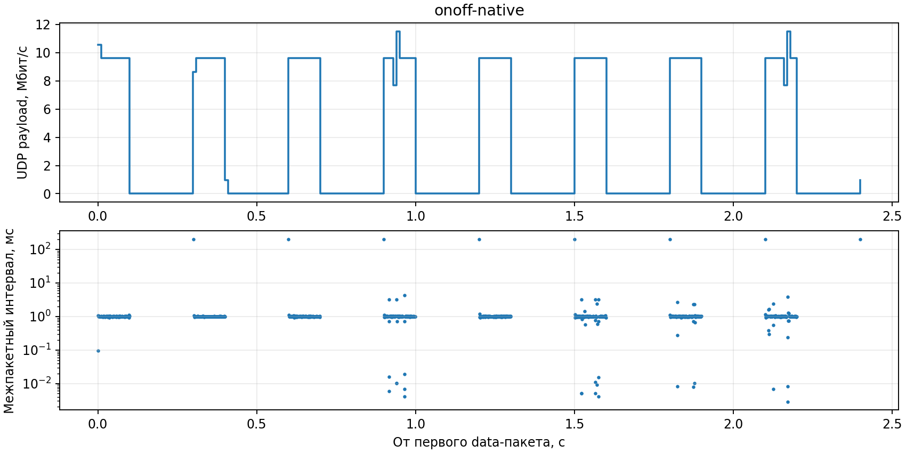
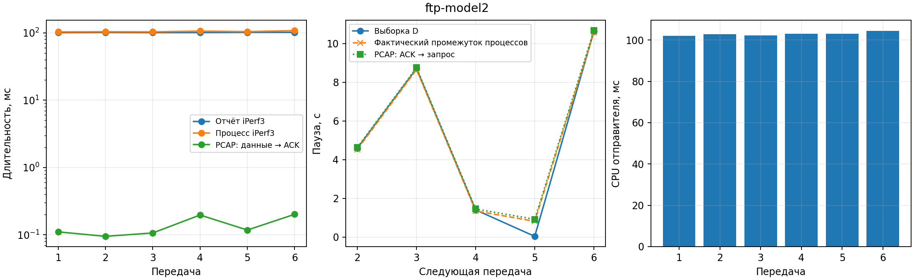

# Обзор исследования: задача, устройство проекта и выводы

**Начните изучение проекта с этого файла.** Здесь объясняется, зачем проводилось исследование, как устроен эксперимент и что означают результаты. Для понимания уже выполненной работы устанавливать инструменты и повторно запускать измерения не требуется.

Материалы имеют разные назначения:

| Материал | На какой вопрос отвечает |
|---|---|
| Этот обзор | Что исследовали, зачем, как связаны этапы и как читать результаты? |
| [Технический отчёт](REPORT_RU.md) | Какие конкретно числа получены и насколько обоснованы выводы? |
| [README](README.md) | Какие команды выполнить, чтобы воспроизвести или изменить эксперимент? |
| [Индекс измерений](results/INDEX.md) | Какие каталоги содержат окончательные результаты, а какие — предварительные пробы? |
| [Источники](references/SOURCES.md) | На какие руководства и параметры моделей опиралась работа? |

## 1. Цель исследования

Цель — определить, насколько iPerf2 и iPerf3 воспроизводят заданную нагрузку и как недостаток CPU изменяет скорость и временную структуру трафика.

Если генератору задано 200 Мбит/с, это ещё не означает, что он действительно отправляет 200 Мбит/с. Он может не успевать формировать пакеты. Даже если он отправил весь объём, часть пакетов может потеряться на пути к приложению-приёмнику. Наконец, средняя скорость может совпадать с заданной, хотя пакеты идут неравномерными пачками.

Поэтому в работе рассматривается вся последовательность:

```text
Заданный профиль нагрузки
          ↓
Генератор и доступное ему процессорное время
          ↓
Фактически отправленные пакеты: объём и интервалы
          ↓
Очереди сокетов и сетевой стек
          ↓
Данные, полученные приложением-приёмником
```

Практический смысл: прежде чем объяснять результат сетевого теста свойствами сети, нужно проверить, что сам источник создал нужную нагрузку и что приёмник смог её обработать.

## 2. Постановка задачи

Исследование разделено на три основные задачи и один контрольный эксперимент.

| Задача | Что требуется воспроизвести или сравнить | Как проверяется |
|---|---|---|
| UDP при ограничении CPU | Одинаковая заданная скорость у iPerf2 и iPerf3 | Сопоставление цели, TX, RX, CPU, PPS и потерь |
| UDP ON/OFF на iPerf2 | Чередование активных интервалов и пауз | Реальные времена пакетов в PCAP |
| FTP-like TCP на iPerf3 | Передача конечного объёма, затем пауза перед следующим | Проверка размера, длительности, CPU и фактической паузы |
| Контроль буфера | Отделить потерю принятых к отправке пакетов от недогенерации | Повтор части UDP-опытов с увеличенным буфером сокета |

**Прямое сравнение двух инструментов выполняется в UDP-матрице.** ON/OFF и FTP-like — дополнительные исследования разных профилей нагрузки. По ним нельзя сравнивать «UDP iPerf2 против TCP iPerf3» как одинаковую задачу.

Критерий успешной реализации проекта — возможность задать сценарий, выполнить его, сохранить исходные измерения и проверить соответствие фактического поведения заданному. Успешное завершение программы само по себе не доказывает точность профиля: обнаруженные отклонения тоже являются результатом исследования.

## 3. Основные понятия

| Понятие | Значение в проекте |
|---|---|
| Целевая скорость, `target_bps` | Сколько бит в секунду генератору поручено отправлять |
| TX, `tx_bps` | Скорость, которую сообщает сторона отправителя; это не гарантия доставки |
| RX, `rx_bps` | Скорость данных, полученных приложением-приёмником |
| Payload | Размер полезной нагрузки UDP-датаграммы; заголовки IP/UDP сюда не входят |
| PPS, `tx_pps` | Число отправляемых пакетов в секунду |
| Потери, `loss_percent` | Доля UDP-пакетов, которую приёмник считает потерянной |
| CPU отправителя | Доля процессорного времени относительно одного логического CPU |
| Квота CPU | Верхняя граница доступного процессорного времени; фактическое потребление может быть ниже |
| Throttling | Принудительная приостановка исполнения после исчерпания CPU-бюджета cgroup |
| PCAP | Захват пакетов с временными метками, позволяющий проверить временную структуру потока |

Скорости здесь относятся к нагрузке генератора, а не к полной скорости с учётом Ethernet/IP/UDP-заголовков на физическом канале. Обозначение «Мбит/с» использует десятичный множитель 1000000.

Для фиксированного payload:

```text
PPS = bitrate / (8 × payload_bytes)
deviation_percent = 100 × (TX / target − 1)
```

При 200 Мбит/с и 128 байтах нужно примерно 195313 пакетов/с, а при 1200 байтах — 20833 пакета/с. Это объясняет выбор двух размеров: одинаковый битрейт может требовать очень разного количества операций с пакетами.

## 4. Среда и границы эксперимента

Измерения выполнены 28.10.2026 на Ubuntu 24.04.4, Linux 7.0.0-38, Intel Core i7-1255U. Использованы iPerf2 2.1.9 и iPerf3 3.16.

Отправитель и приёмник работали на одной машине через `127.0.0.1`, то есть через loopback. Отправитель закреплён за CPU 0, приёмник — за другим физическим ядром, CPU 2. Это уменьшает прямую конкуренцию двух приложений за одно ядро. Физический сетевой интерфейс и внешняя сеть в этих опытах не участвуют, но очереди сокетов и сетевой стек Linux участвуют.

Такая схема удобна для первого этапа исследования: можно изучать ограничения генератора без неизвестной пропускной способности внешнего канала. Она не заменяет испытания на двух отдельных машинах и не даёт оценки производительности физической сети.

## 5. Что было сделано последовательно

### Этап 1. Проверка среды и короткие пробы

Сначала были проверены инструменты, версии, возможность запуска локальных соединений, доступность cgroup v2 и захвата пакетов. iPerf2/iPerf3 отсутствовали, поэтому Ubuntu-пакеты скачаны и распакованы внутри `.tools/` без системной установки.

Ограничение CPU заработало через пользовательские сервисы `systemd`. Обычный tcpdump не получил необходимых прав; для захвата использован отдельный временный Docker-контейнер с правом `NET_RAW`. Контейнер выполняет захват на хосте, а не переносит в себя весь эксперимент. Его назначение — получить PCAP; CPU отправителя ограничивает cgroup, создаваемый runner.

Перед основной серией выполнялись короткие тесты. Они выявили три существенных особенности:

1. В iPerf2 2.1.9 фактическая единица `--ipg` — миллисекунда, хотя man-страница указывает секунды. Различие подтверждено захватом, а не только справкой.
2. Этот бинарник отвергает совместное использование `-b` с `--isochronous`/`--ipg`. Формирование команды исправлено до основной серии.
3. Для очень коротких захватов понадобился `--immediate-mode`: без него пакеты могли остаться во внутреннем буфере захвата до его завершения.

Неуспешные пробы сохранены для проверки истории работы. Они не добавлялись к окончательной статистике. Их перечень приведён в [индексе измерений](results/INDEX.md).

### Этап 2. Общая автоматизация

Вместо ручного повторения команд создан Python-пакет `netperf_lab`. Он читает JSON-сценарии, управляет процессами и записывает результаты каждого опыта отдельно.

Для одного UDP-опыта порядок следующий:

1. Читаются параметры и проверяется наличие нужных опций установленного инструмента.
2. Запускается соответствующий приёмник: iPerf2 server для iPerf2 client либо iPerf3 server для iPerf3 client.
3. Создаётся отдельный пользовательский сервис для отправителя; при необходимости ему задаётся CPU-квота.
4. Worker закрепляет процесс за выбранным CPU, проверяет реальное `cpu.max` и запускает iPerf.
5. Внешний монитор снимает CPU-сэмплы; worker получает итоговое CPU-время через `wait4` после завершения iPerf.
6. Сохраняются stdout/stderr, команды, сведения о cgroup и системные счётчики; из вывода сторон извлекаются метрики.
7. Опыт завершается, и runner переходит к следующему набору параметров.

Для ON/OFF и TCP дополнительно запускается захват пакетов. В UDP CPU-матрице capture отключён, чтобы не добавлять его нагрузку к сравнению.

Сбор данных, обработка и аудит — отдельные действия:

```text
run     → исходные результаты отдельных опытов
analyze → сводные таблицы и графики
audit   → проверки согласованности и полноты сохранённых результатов
```

Это позволяет перепостроить графики по уже имеющимся данным без повторной генерации трафика.

### Этап 3. Сравнение UDP при разных квотах CPU

Основная матрица содержит:

| Изменяемый параметр | Значения | Зачем он нужен |
|---|---|---|
| Инструмент | iPerf2, iPerf3 | Сравнить генераторы при одинаковой задаче |
| CPU-квота | Без квоты, 100%, 50%, 25% | Проверить чувствительность к доступному CPU-времени |
| Цель | 10 и 200 Мбит/с | Сопоставить меньшую и большую нагрузку |
| UDP payload | 128 и 1200 байт | Изменить PPS при той же целевой скорости |
| Повторы | Три | Увидеть разброс между запусками |

Всего: `2 × 4 × 2 × 2 × 3 = 96` опытов по две секунды. Опыты выполняются последовательно; их порядок перемешан с фиксированным seed, чтобы не проводить все режимы одного инструмента подряд.

**«Без квоты» тоже означает закрепление за одним логическим CPU.** Это не разрешение занять все ядра машины. Режим 100% сохраняет явное ограничение одного CPU, а режим без квоты не вводит такого бюджетного ограничения; их сравнение служит дополнительной проверкой базового режима.

Период квоты — 100 мс. Например, 25% — бюджет около 25 мс CPU за период 100 мс для группы. Это не плавное замедление генератора до четверти скорости: процесс может работать, затем ожидать возобновления бюджета. Поэтому проверяется не только средний TX, но и throttling, RX и потери.

### Этап 4. Проверка ON/OFF на iPerf2

ON/OFF — поток, в котором активная передача чередуется с паузой. Для основной периодической пробы заданы ON=100 мс, OFF=200 мс, скорость в ON=9,6 Мбит/с и payload=1200 байт.

В реализации `isochronous` iPerf2 формирует периодические кадры-пачки. Для нужного профиля рассчитаны:

| Величина | Значение | Смысл |
|---|---:|---|
| Период | 300 мс | Один ON плюс один OFF |
| Частота кадров | 3,333…/с | Сколько пачек должно начинаться в секунду |
| Средняя скорость | 3,2 Мбит/с | 9,6 Мбит/с с долей активности 1/3 |
| Шаг пакетов внутри пачки | 1 мс | 1200 × 8 бит при 9,6 Мбит/с |

Таким образом, `--isochronous` задаёт период и объём пачки, а `--ipg` распределяет её пакеты по активному интервалу. Это приближение ON/OFF средствами генератора, которое затем проверяется по PCAP.

Для 100 пакетов с шагом 1 мс интервал от первого до последнего составляет 99 мс. Поэтому `burst_span_s` около 99 мс не следует автоматически трактовать как ошибку относительно ON=100 мс: окно активности и расстояние между крайними пакетами — разные величины.

Также реализован способ `sessions`: отдельный процесс iPerf2 на каждый ON, затем пауза и запуск следующего. Он позволяет задавать случайные длительности, но фактический OFF включает дополнительные задержки завершения и запуска процессов. Равномерные и экспоненциальные случайные интервалы в проекте используются именно с этим способом.

Отдельно проверены `--burst-period` и `--burst-size`. Бинарник принял опции, однако в выполненном UDP-тесте они не создали требуемые периодические паузы. Это важное различие между «опция распознана» и «нужный профиль воспроизведён».

### Этап 5. FTP-like TCP и модель чтения

Здесь моделируется пользователь, который передаёт конечный объём данных, затем делает паузу перед следующей передачей. Используется `iperf3 -n N`, где N — число байтов. Настоящий FTP-сеанс и работу с диском проект не воспроизводит.

Для сценария по параметрам FTP Model 2 выбран один пользователь, файл 500000 байт и экспоненциальное время чтения со средним 5 с. «Среднее 5 с» не означает одинаковую паузу 5 с после каждого файла: отдельные выборки бывают значительно меньше или больше. В этом сценарии выполнены шесть передач; ещё шесть передач проверяют размеры 500000, 5000000 и 50000000 байт.

Размер блока `-l` выбирается делителем размера файла, чтобы `-n` не привёл к передаче лишнего полного блока. Полученный объём проверяется как по отчётам сторон, так и по TCP sequence ranges в захвате.

Обнаружилось, что для короткой передачи длительность в итоговом JSON iPerf3 значительно превышает сетевой интервал передачи. Поэтому сохраняются три разные величины:

| Измерение | Что включает | Для чего смотреть |
|---|---|---|
| `transfer_seconds` | Интервал, сообщённый самим iPerf3 | Поведение и отчётность инструмента |
| `process_wall_s` | Время жизни процесса | Полные накладные расходы запуска и выполнения |
| `pcap_completion_ack_span_s` | Первый пакет данных файла → полный TCP ACK | Сетевой интервал до подтверждения всего файла |

Полный ACK означает подтверждение байтов TCP-стеком принимающей стороны. Это не подтверждение записи файла на диск.

При наличии PCAP следующая пауза планируется относительно полного ACK предыдущего файла. Но если программа ещё завершает предыдущий тест или готовит следующий, фактический запрос может опоздать. Поэтому выборка D и измеренное ACK→следующий SYN сохранены отдельно. Точная экспоненциальная последовательность фактических запросов в этой реализации не достигнута, особенно для очень малых D.

### Этап 6. Контроль влияния буфера

В части UDP-опытов отправитель почти достигал цели, но приёмник сообщал потери. Одновременно росли счётчики ошибок приёмного буфера Linux. Чтобы проверить этот фактор, выполнены ещё девять опытов iPerf3: 200 Мбит/с, payload 1200, квоты без ограничения/50/25%, по три повтора, с запросом буфера 4194304 вместо 1048576 байт.

Контроль был нужен для ответа на отдельный вопрос: «Данных мало потому, что отправитель не создал их, или потому, что часть отправленного потока не дошла до приложения?» Изменение буфера не заменяет CPU-матрицу, а помогает интерпретировать её результаты.

## 6. Как читать результаты

### 6.1. Сначала — график UDP с маленькими пакетами



По горизонтали на всех четырёх панелях — режим CPU-квоты. Слева направо показаны TX, CPU отправителя, PPS и потери на приёмнике. Цвет обозначает генератор; вертикальные отрезки показывают SD трёх повторов.

Сначала сравните TX с пунктирной целевой скоростью. Затем посмотрите, исчерпан ли CPU-бюджет в том же режиме. После этого проверьте потери. Такое чтение позволяет отличить недогенерацию от недоставки.

Например, при квоте 25% iPerf2 отправляет в среднем 125,74 Мбит/с вместо 200 Мбит/с, потребляет 24,9% CPU и имеет нулевые потери RX. Основное отклонение здесь возникает до приёма: источник создаёт меньше трафика, чем задано.

### 6.2. Затем — временной профиль ON/OFF



Верхняя панель показывает скорость, посчитанную по коротким временным окнам захвата. На ней должны различаться активные участки и паузы. Нижняя панель показывает межпакетные интервалы в логарифмическом масштабе: около 1 мс внутри пачки и около 200 мс между пачками.

Кратковременное превышение 9,6 Мбит/с на верхней панели само по себе не означает превышения средней цели: на такой график влияют границы временных окон и неравномерность отправки. Для проверки отдельных интервалов служат `packets.csv`, а для пачек — `bursts.csv`. Маленький хвост в конце — фактически наблюдавшаяся неполная последняя пачка.

### 6.3. После этого — три времени TCP-передачи



На левой панели сравниваются отчёт iPerf3, жизнь процесса и сетевой интервал по PCAP. Шкала логарифмическая: разрыв между примерно 0,1 мс и 100 мс принципиален. Центральная панель сопоставляет выбранную паузу и фактические промежутки. Правая показывает CPU-время всего процесса, включая управление после передачи данных.

Этот график нужно читать вместе с определениями времени: большая длительность процесса не доказывает медленную передачу файла по сети.

### 6.4. Как проверить одно число до исходных данных

Начните со [сводной UDP-таблицы](results/research-2026-10-28/udp-matrix/summary.csv): одна строка соответствует сочетанию инструмента, квоты, цели и payload, усреднённому по повторам. Суффиксы `_mean`, `_sd`, `_min`, `_max` обозначают среднее, SD, минимум и максимум.

Затем откройте [таблицу отдельных UDP-опытов](results/research-2026-10-28/udp-matrix/results.csv). Поле `trial` указывает каталог конкретного запуска. Его номер отражает перемешанный порядок опытов, а не величину квоты.

Пример — [trial-012/metrics.json](results/research-2026-10-28/udp-matrix/trial-012/metrics.json): iPerf2, квота 25%, payload 128 байт, цель 200 Мбит/с. В этом отдельном запуске TX=119,76 Мбит/с, CPU≈24,98%, потери=0%, число событий throttling=20. Это один повтор; среднее трёх повторов 125,74 Мбит/с отличается от него закономерно.

В том же каталоге:

| Файл | Что позволяет проверить |
|---|---|
| `sender-spec.json` | Точную команду клиента и параметры worker |
| `receiver-command.json` | Команду принимающей стороны |
| `client.stdout`, `receiver.stdout` | Исходные сообщения iPerf, из которых извлечены скорости и потери |
| `sender-metadata.json` | Привязку CPU и фактическое состояние cgroup перед запуском |
| `sender-accounting.json` | CPU-время процесса и состояние cgroup после опыта |
| `cpu-samples.csv` | Изменение накопленного CPU-времени в ходе опыта |
| `host-before.json`, `host-after.json` | Системные счётчики до и после |

Небольшое превышение RX bitrate над TX bitrate возможно из-за различия интервалов учёта сторон. Его нельзя трактовать как создание дополнительных данных; при сомнении нужно сравнивать объёмы и определения интервалов.

## 7. Какие выводы обоснованы

### Вывод 1. Целевая скорость не является измеренной скоростью

При 200 Мбит/с и 128 байтах квота 25% ограничила TX до 125,74 Мбит/с у iPerf2 и 118,47 Мбит/с у iPerf3. CPU-бюджет исчерпывался, наблюдался throttling. В этих условиях ограничение отправителя действительно влияет на создаваемую нагрузку.

### Вывод 2. CPU-затраты инструментов на этом хосте различаются

При 10 Мбит/с и payload 1200 без квоты iPerf2 потреблял около 3,14% одного CPU, iPerf3 — 99,69%, хотя TX у обоих близок к цели. Это установленное различие данных версий в данном окружении. Причина высокой загрузки iPerf3 на уровне его исходного кода не установлена; универсальный вывод о всех версиях не делается.

### Вывод 3. Потери RX и недогенерация — разные проблемы

У iPerf3 при 200 Мбит/с, payload 1200 и квоте 25% увеличение запрошенного буфера изменило результат:

| Буфер | Средний TX, Мбит/с | Средний RX, Мбит/с | Потери |
|---|---:|---:|---:|
| 1048576 байт | 198,54 | 162,72 | 17,55% |
| 4194304 байт | 199,87 | 199,79 | 0% |

Переданная нагрузка почти не изменилась, а доставка приложению улучшилась. Вместе со счётчиками `RcvbufErrors` это указывает на существенное влияние буферизации. Однако `-w` меняет буферы обеих сторон, а счётчики общие для хоста: эксперимент не изолирует все возможные причины потерь.

### Вывод 4. Native ON/OFF достаточно близок к выбранному профилю, но не точен

В периодическом тесте медианный IPG составил около 1 мс, интервал между крайними пакетами основных пачек — около 99 мс, промежуток между пачками — около 201 мс. При выбранной нагрузке квота 25% существенно не нарушила профиль. Однако присутствует неполный последний кадр; точный gate и полное отсутствие служебного обмена в OFF не обеспечиваются.

Способ с отдельными процессами имеет другой компромисс: при заданном OFF=200 мс медианный фактический промежуток составил около 259 мс. Он удобен для случайных длительностей, но точность расписания хуже.

### Вывод 5. Короткую TCP-передачу нужно измерять несколькими способами

Для файлов 500000 байт в сценарии Model 2 PCAP показал 0,095–0,202 мс до полного ACK, а итог iPerf3 — примерно 100,6–101,5 мс. Отдельная проба выявила зависимость итоговой длительности от отчётного интервала. Делить размер короткого файла на это время и объявлять результат пропускной способностью сети некорректно без оговорки о методике.

### Вывод 6. Параметры FTP Model 2 поддержаны, точность фактических пауз ограничена

Генератор выбирает экспоненциальные D со средним 5 с и сохраняет их. Но для D≈0,038 с фактический промежуток оказался около 0,919 с; для более длинных пауз наблюдались дополнительные 44–49 мс. Поэтому текущая реализация — приближение с отдельным процессом на файл, а не точное воспроизведение распределения моментов запросов.

## 8. Что проверено и чего работа пока не доказывает

В окончательных наборах выполнены 105 UDP-опытов, 12 TCP-передач и пять ON/OFF/burst-сценариев. Все 12 размеров файлов совпали с запросом и проверены по PCAP. Подготовлены 14 графиков в PNG/SVG. Пять unit-тестов прошли; аудит сохранённых измерений прошёл 402 проверки: 366 в основной серии и 36 в контроле буфера.

Эти проверки подтверждают проверяемые свойства артефактов — квоты, повторения, размеры, полноту захвата и согласованность данных. Они не превращают пилотное исследование в доказательство производительности оборудования при любых условиях.

Границы выводов:

- Двухсекундные тесты и три повтора характеризуют пилотную серию; длительная стабильность не исследована.
- Фоновые процессы, энергосбережение и сетевые offloads не отключались; capture добавляет нагрузку в ON/OFF и FTP-сценариях.
- Cgroup ограничивает процессы отправителя; вся работа сетевого стека и softirq не обязательно учитывается в этой группе.
- Физическая сеть и реальный удалённый приёмник не испытывались. SSH-шаблон существует, но его работоспособность реальными опытами не подтверждена.
- Многопользовательская модель FTP не реализована; используется один пользователь. Настоящий FTP-протокол, диск и задержки внешнего канала не моделируются.
- Оригинал TR 36.814 напрямую скачать не удалось; параметры модели сверены по индексированному тексту. Условия доступа и источники описаны в [SOURCES.md](references/SOURCES.md).

Следующее расширение исследования — более длительные повторы на двух выделенных машинах, отдельное изучение высокой CPU-загрузки iPerf3 и уменьшение накладных расходов между TCP-передачами. Это предложения для следующего этапа, а не выполненные результаты.

## 9. В каком порядке изучать проект дальше

1. Прочитайте этот обзор и три встроенных графика. На этом этапе должно быть понятно, чем отличаются цель, TX, RX и время жизни процесса.
2. Откройте [технический отчёт](REPORT_RU.md): там компактные числовые результаты и ссылки на подтверждающие таблицы.
3. Разберите один опыт по примеру `trial-012` выше. Это связывает усреднённый вывод с конкретной командой и исходным измерением.
4. Посмотрите [основную конфигурацию](configs/research-local.json): сопоставьте её восемь сценариев с этапами этого обзора. Девять опытов контроля буфера описаны [отдельной конфигурацией](configs/socket-buffer-control.json).
5. Если нужна реализация, читайте код по таблице ниже. Предварительные пробы можно изучить позже по [индексу](results/INDEX.md).
6. Для повторного запуска перейдите к [README](README.md): сначала проверка среды и короткий smoke, затем полная серия и обработка результатов.

| Порядок чтения кода | Ответственность |
|---|---|
| [__main__.py](netperf_lab/__main__.py) | Команды `doctor`, `run`, `analyze` |
| [environment.py](netperf_lab/environment.py) | Описание среды, версии, справки, контрольные суммы |
| [experiments.py](netperf_lab/experiments.py) | Сценарии UDP, ON/OFF и FTP; порядок опытов и выбор параметров |
| [control.py](netperf_lab/control.py) | Жизненный цикл приёмника, отправителя, захвата и CPU-монитора |
| [worker.py](netperf_lab/worker.py) | Привязка CPU, проверка cgroup и итоговый учёт CPU-времени |
| [metrics.py](netperf_lab/metrics.py) | Извлечение чисел из CSV iPerf2 и JSON iPerf3 |
| [pcap.py](netperf_lab/pcap.py) | Времена UDP-пакетов, пачки, TCP-объём и полный ACK |
| [analysis.py](netperf_lab/analysis.py) | Усреднение повторов и построение графиков |
| [audit_results.py](scripts/audit_results.py) | Проверка сохранённых измерений и формирование `verification.json` |

Связь материалов при проверке любого вывода должна быть такой: **вопрос исследования → параметры сценария → график и сводная таблица → отдельный опыт → исходный вывод инструмента или PCAP**.
